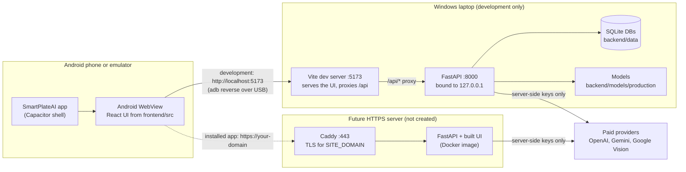

# SmartPlateAI — Android App Development Guide

*Prepared 2026-10-28 by inspecting this project and the published Capacitor 8.5.3 packages. Nothing in this guide has been
implemented yet: no Android project exists, no Capacitor package is installed, and no Android build or device test has been run.*

How to read the labels used throughout:

| Label | Meaning |
|---|---|
| **[Verified]** | Checked on this laptop or in this project's source on 2026-10-28 (file and line given where useful). |
| **[Capacitor source]** | Checked in the published `@capacitor/android@8.5.3` / `@capacitor/cli@8.5.3` package code. |
| **[Docs]** | Taken from official Capacitor or Gradle documentation. |
| **[Recommendation]** | A suggestion for the implementation phase. Nothing has been changed. |
| **[Pending]** | Must be checked by you when you implement. It has not been run. |
| **[Needs approval]** | Touches authentication, environment files, deployment configuration, dependencies of the backend, paid services or cloud resources. Do not do it without an explicit decision. |

---

## Contents

- [Summary: the three decisions that matter](#summary-the-three-decisions-that-matter)
- [A. Project architecture and feasibility](#a-project-architecture-and-feasibility)
- [B. Prerequisites and installation](#b-prerequisites-and-installation)
- [C. Prepare the existing React application](#c-prepare-the-existing-react-application)
- [D. Add Capacitor safely](#d-add-capacitor-safely)
- [E. Connect the Android app to the backend](#e-connect-the-android-app-to-the-backend)
- [F. Android permissions and native integration](#f-android-permissions-and-native-integration)
- [G. Authentication, uploads and API security](#g-authentication-uploads-and-api-security)
- [H. Run the Android application](#h-run-the-android-application)
- [I. Build a debug APK](#i-build-a-debug-apk)
- [J. Production backend and release readiness](#j-production-backend-and-release-readiness)
- [K. Troubleshooting](#k-troubleshooting)
- [L. Testing checklist](#l-testing-checklist)
- [M. Rollback and file protection](#m-rollback-and-file-protection)
- [N. Final step-by-step implementation plan](#n-final-step-by-step-implementation-plan)
- [Appendix: facts that could not be verified](#appendix-facts-that-could-not-be-verified)

---

## Summary: the three decisions that matter

1. **Capacitor fits this project. No Kotlin rewrite is needed.** The frontend is a standard Vite + React single-page app that
   builds to static files in `frontend/dist`, routes on the client, and calls the API through one base-URL constant. Capacitor
   can wrap it unchanged for development.

2. **Sign-in is the main obstacle for a bundled APK.** The sign-up page creates accounts that use an **HttpOnly cookie** session,
   not a token ([Verified]: see [G.1](#g1-how-sign-in-works-today-verified)). Inside a bundled Capacitor app the page's address
   is `https://localhost`, so a cookie from a backend at any other address is a *third-party* cookie. The cookie is set with
   `SameSite=Lax`, and Capacitor's Android WebView does not enable third-party cookies ([Capacitor source]). Sign-in would appear
   to succeed and then not stick. Two working options:
   - **Development (works without changing any code):** let the app load the Vite dev server (`http://localhost:5173`,
     forwarded to the phone with `adb reverse`). The page and `/api` then share one origin, exactly as in your desktop browser.
   - **Installed app:** either (a) let the app load your *deployed* HTTPS site (`server.url`), which is the same origin as its
     API, or (b) bundle the web files in the APK *and* change sign-in to the existing bearer-token mechanism. Option (b) changes
     authentication behaviour and is **[Needs approval]**. See [J.3](#j3-choosing-how-the-installed-app-loads-smartplateai).

3. **Java version trap on this laptop.** Android Studio 2026.2 bundles Java **25** ([Verified]). The Android project that
   Capacitor 8.5.3 generates uses Gradle **8.14.3** ([Capacitor source]), and Gradle 8.14 can run on Java up to 24 only; Java 25
   needs Gradle 9.1 ([Docs]: Gradle compatibility matrix). Set Android Studio's *Gradle JDK* to your installed
   **JDK 24** (`C:\Program Files\Java\jdk-24`) instead of upgrading anything. See [B.3](#b3-jdk-the-version-trap).

---

## A. Project architecture and feasibility

### A.1 What exists today [Verified]

| Part | Facts found in the project |
|---|---|
| Frontend | React 19, TypeScript 6, Vite 8, Tailwind 4, React Router 7, `lucide-react` icons. Scripts in [frontend/package.json](frontend/package.json): `dev` = `vite`, `build` = `tsc -b && vite build`, `lint` = `oxlint`, `preview` = `vite preview`. No `test` script; the tests in `frontend/tests/` (`authDestination.test.ts`, `recognitionConfidence.test.ts`) run with `node --test --experimental-strip-types`. |
| Build output | `frontend/dist` (Vite default; `vite.config.ts` does not override `build.outDir`). |
| Dev server | [frontend/vite.config.ts](frontend/vite.config.ts): `server.host: '0.0.0.0'` (it already listens on every network interface, not only localhost) and `server.proxy: { '/api': 'http://127.0.0.1:8000' }`. |
| API base URL | [frontend/src/lib/foodApi.ts:163](frontend/src/lib/foodApi.ts#L163): `export const API_BASE = (import.meta.env.VITE_API_BASE_URL as string \| undefined) ?? ''`. Every API module (`api.ts`, `authApi.ts`, `chatApi.ts`, `foodApi.ts`, `packagedApi.ts`) imports this one constant. Empty means "same origin" (`/api/...`). There are no `frontend/.env*` files. |
| Routing | `BrowserRouter` ([frontend/src/main.tsx](frontend/src/main.tsx)) with routes in [frontend/src/App.tsx](frontend/src/App.tsx): `/`, `/analyze`, `/signin`, `/signup`, and inside the app shell `/scan-packaged`, `/compare`, `/chemical`, `/chat`, `/bmi`, plus signed-in-only `/dashboard`, `/history`, `/nutrition`, `/meal-planner`, `/allergens`, `/reports`, `/profile`. |
| Backend | FastAPI app `app.main:app`. Run command from [README.md](README.md): `cd D:\SmartPlateAI\backend` then `.\.venv\Scripts\python.exe -m uvicorn app.main:app --host 127.0.0.1 --port 8000` (no `--reload`, because it loads TensorFlow twice). Health checks: `/health`, `/api/models/status`, `/api/packaged/status`, `/api/chat/status`. |
| Backend CORS | [backend/app/main.py](backend/app/main.py) `CORSMiddleware` with `allow_origins=settings.cors_origin_list`, `allow_credentials=True`. Default `CORS_ORIGINS` = `http://localhost:5173,http://127.0.0.1:5173` ([backend/app/core/config.py:15](backend/app/core/config.py#L15)). |
| Production layout | [Dockerfile](Dockerfile) builds the frontend and sets `SERVE_FRONTEND_DIR=/app/frontend/dist`, so **one HTTPS origin serves both the React app and `/api`** behind Caddy ([deploy/Caddyfile](deploy/Caddyfile), domain from `SITE_DOMAIN`). Not deployed. |
| Upload limits | 8 MB per photo in the UI (`MAX_MB = 8` in `FoodAnalyzer.tsx` and `PackagedAnalyzer.tsx`) and on the server (`MAX_UPLOAD_MB`, default 8, in `backend/app/api/routes/analyze.py`). Whole request ≤ `MAX_REQUEST_MB` (30) and JSON ≤ `MAX_JSON_KB` (1024). |
| Capacitor | **Not present.** No `@capacitor/*` dependency, no `capacitor.config.*`, no `frontend/android/` folder. |
| Version control | The project folder is **not a git repository**. Backups are dated folders (`backups/…`, `_backup_*`). |

### A.2 How Capacitor wraps the React app

Capacitor generates a small native Android project (`frontend/android/`). Its one screen (`MainActivity`) contains an Android
**WebView**, the same Chromium engine that Chrome uses. The WebView shows one of two things:

- **Bundled mode (default):** the files from `frontend/dist` are copied into the APK (`android/app/src/main/assets/public/`)
  and served by Capacitor's built-in local server at **`https://localhost`** ([Capacitor source]: `CapConfig` default
  `hostname = "localhost"`, `androidScheme = "https"`). Paths without a file extension (such as `/dashboard`) are answered with
  `index.html`, which suits `BrowserRouter` ([Capacitor source]: `WebViewLocalServer`).
- **URL mode (`server.url`):** the WebView loads a web address instead, either your Vite dev server (for live reload) or a
  deployed site.

**What Capacitor provides:** the Android project and Gradle build, an app icon and splash screen, a bridge to native plugins,
Android runtime permission prompts for the camera when the page calls `getUserMedia` ([Capacitor source]:
`BridgeWebChromeClient.onPermissionRequest`), and native handling of `<input type="file">` (system file picker, or the camera
app when the input has `capture`).

**What Capacitor does not provide:** a backend, offline AI, a reachable server, HTTPS certificates, or a way around browser
security rules (CORS, mixed content, third-party cookies). It also does **not** save files started by
`<a download>` with a `blob:` URL: there is no `DownloadListener` in Capacitor's Android code ([Capacitor source]). That is how
PDF reports are downloaded today (`download()` in [frontend/src/lib/api.ts](frontend/src/lib/api.ts)). See
[F.4](#f4-pdf-report-downloads-known-gap).

### A.3 Proposed architecture



Request flow for a food photo in development: the phone's WebView sends `POST /api/analyze/food` to `http://localhost:5173`.
`adb reverse` carries it over USB to the laptop's port 5173, where Vite forwards it to `http://127.0.0.1:8000`. FastAPI runs the
local models (and, if enabled in `backend/.env`, paid providers), and the JSON result travels back the same way.

### A.4 Files: reused, added, changed

| Reused unchanged [Verified] | Notes |
|---|---|
| All of `frontend/src/` | Pages, components, API modules, session handling. |
| `frontend/public/` | Images, favicon. Copied into `dist` by Vite. |
| `frontend/vite.config.ts` | The proxy and `0.0.0.0` host already support device testing. |
| The whole `backend/` | No backend change is needed for development mode. |
| `deploy/`, `Dockerfile`, `docs/DEPLOYMENT.md` | Unchanged for development. |

| Added during implementation [Recommendation] | Created by |
|---|---|
| `frontend/capacitor.config.ts` | `npx cap init`, then edited (Section D) |
| `frontend/android/` (the native project, roughly 1–2 MB of source; builds add hundreds of MB under `android/app/build` and `android/.gradle`) | `npx cap add android` |
| `@capacitor/core`, `@capacitor/android` (dependencies), `@capacitor/cli` (dev dependency) in `frontend/package.json` and `package-lock.json` | `npm install` |

| Changed during implementation | Status |
|---|---|
| `frontend/android/app/src/main/AndroidManifest.xml`: add the camera permission | [Recommendation], Section F |
| `.dockerignore`: add `frontend/android` | **[Needs approval]**. Today `Dockerfile` line 10 runs `COPY frontend/ ./` and `.dockerignore` does not exclude `android`, so the native project and its build output would enter the Docker build context. |
| `backend/scripts/make_deploy_bundle.py`: add `"android"` to `SKIP_DIRS` | **[Needs approval]**. Its allowlist includes `frontend`, and `SKIP_DIRS` skips only `node_modules`, `dist`, `__pycache__`, `.vite` and `tests`. |
| Sign-in flow for a bundled APK | **[Needs approval]**, only if you choose option (b) in [J.3](#j3-choosing-how-the-installed-app-loads-smartplateai). |
| PDF downloads inside the app | Optional new plugins **[Needs approval]**, [F.4](#f4-pdf-report-downloads-known-gap). |

### A.5 Why `localhost` on the phone is not your laptop

`localhost` (`127.0.0.1`) always means *the device the code runs on*. On your laptop it is the laptop; inside the Android
emulator it is the emulator; on your phone it is the phone. A phone has no FastAPI server, so `http://127.0.0.1:8000` from the
phone reaches nothing (`ERR_CONNECTION_REFUSED`). The ways to reach the laptop are:

- **`adb reverse tcp:5173 tcp:5173`** (emulator or USB phone): asks Android to forward the *phone's* `localhost:5173` to the
  *laptop's* port 5173 over USB/ADB. Nothing is opened on your network. This is the recommended development path.
- **`10.0.2.2`** (emulator only): a special address for the host computer's loopback interface ([Docs]: Android emulator
  networking).
- **The laptop's Wi-Fi IP** (phone on the same Wi-Fi): needs the Windows firewall to allow the port, and works only while both
  devices are on that network.
- **A public HTTPS domain** (installed app used anywhere): needs a deployed server ([J](#j-production-backend-and-release-readiness)).

---

## B. Prerequisites and installation

### B.1 What is already installed [Verified 2026-10-28]

| Tool | Found | Capacitor 8 requirement | Status |
|---|---|---|---|
| Node.js | v24.14.1 | ≥ 22 (`@capacitor/cli@8.5.3` `engines.node`) | OK |
| npm | 11.11.0 | — | OK |
| Android Studio | 2026.2 (build AI-262.9437.185…), installed at **`C:\Users\HP\OneDrive\Desktop\New folder`** | ≥ 2025.2.1 ([Docs]) | OK. The folder name is unusual and inside OneDrive (see note). |
| Android Studio bundled JDK (JBR) | OpenJDK 25.0.3 | — | **Too new for Gradle 8.14.3**, see B.3 |
| Separate JDK | Oracle JDK 24.0.1 at `C:\Program Files\Java\jdk-24` (also the `java` on PATH) | Capacitor 8 compiles Java 21 source; Gradle 8.14 runs on Java ≤ 24 | Use this one for Gradle |
| Android SDK | `C:\Users\HP\AppData\Local\Android\Sdk` | — | Present |
| SDK platforms | `android-32`, `android-33`, `android-34`, `android-34-2`, `android-34.backup`, `android-36-ext19` | compileSdk **36** | [Pending]: plain `android-36` is not present; Android Studio may ask to install "Android SDK Platform 36" |
| Build tools | 30.0.3, 36.1.0, 37.0.0 | AGP chooses its own default | [Pending]: Android Studio may download another version |
| Platform tools | adb 1.0.41 (37.0.0) | — | Present, **not on PATH** |
| Emulator + images | `system-images/android-36-ext19/google_apis/x86_64` | — | Present |
| Virtual devices | `Pixel_3a_API_36`, `Pixel_3a_API_36_extension_level_19_x86_64` | — | Present |
| `cmdline-tools` (`sdkmanager`) | Not found | Optional | Install from SDK Manager only if you want `sdkmanager` on the command line |
| `JAVA_HOME`, `ANDROID_HOME` | Not set | Needed only for command-line Gradle builds | Set per session (B.4) |

> **Note on the Android Studio folder.** It lives in `OneDrive\Desktop\New folder`. OneDrive sync can lock or offload files
> ("files on demand") and slow or break the IDE. Do not move it in the middle of this work. If you see odd file-lock errors
> later, consider reinstalling to the default location as a separate, deliberate step.

You do **not** need to reinstall Node, Android Studio, the SDK or the JDK.

### B.2 Commands to inspect versions (PowerShell)

```powershell
node -v                                   # need v22 or newer
npm -v
java -version                             # the JDK on PATH (currently 24.0.1)
& "C:\Users\HP\OneDrive\Desktop\New folder\jbr\bin\java.exe" -version    # Android Studio's bundled JDK (currently 25)

$sdk = "$env:LOCALAPPDATA\Android\Sdk"
Get-ChildItem "$sdk\platforms" -Name      # installed Android API levels
Get-ChildItem "$sdk\build-tools" -Name
& "$sdk\platform-tools\adb.exe" version
& "$sdk\emulator\emulator.exe" -list-avds # virtual devices
"JAVA_HOME=[$env:JAVA_HOME]  ANDROID_HOME=[$env:ANDROID_HOME]"
```

To check Capacitor versions on npm without installing anything:

```powershell
npm view @capacitor/core version          # 8.5.3 on 2026-10-28
npm view @capacitor/cli engines           # node >=22.0.0
```

### B.3 JDK: the version trap

- Gradle 8.14.x supports **running** on Java 24 at most; Java 25 needs Gradle 9.1.0 or newer ([Docs]: docs.gradle.org
  compatibility matrix, rows "24 → 8.14" and "25 → 9.1.0").
- `@capacitor/cli@8.5.3`'s Android template pins `gradle-8.14.3-all.zip` and the Android Gradle Plugin 8.13.0
  ([Capacitor source]: `gradle-wrapper.properties`, `build.gradle`). Capacitor's library compiles with
  `JavaVersion.VERSION_21`.
- If Android Studio uses its bundled JBR 25 as the Gradle JDK, sync will most likely fail with a message about an incompatible
  Java version or "Unsupported class file major version 69" ([Pending]: confirm on first sync).

**Safe fix (no installs, no upgrades):** in Android Studio open **File → Settings → Build, Execution, Deployment → Build Tools
→ Gradle → Gradle JDK** and choose **`C:\Program Files\Java\jdk-24`** (add it with "Add JDK…" if it is not listed). This
setting is per project and is stored in `frontend/android/.idea/`, so it does not affect other projects.

Do not upgrade the Gradle wrapper to 9.x to suit Java 25: AGP 8.13 and Capacitor 8.5.3 were released against Gradle 8.14.3.
(The Capacitor docs say a separate JDK is not needed because Android Studio provides one. That holds when the bundled JDK
matches; here it does not, which is why JDK 24 is used.)

### B.4 Environment variables for command-line builds (per session only)

Android Studio does not need these. Set them **only in the PowerShell window** where you run `gradlew.bat` or `npx cap run`.
They disappear when the window closes, so nothing system-wide changes:

```powershell
$env:JAVA_HOME    = 'C:\Program Files\Java\jdk-24'
$env:ANDROID_HOME = "$env:LOCALAPPDATA\Android\Sdk"
$env:Path         = "$env:ANDROID_HOME\platform-tools;$env:ANDROID_HOME\emulator;$env:Path"
adb version        # now works without the full path
```

### B.5 Common installation issues

| Symptom | Likely cause | Fix |
|---|---|---|
| `npx cap` says Node is too old | Node < 22 | Not the case here (v24.14.1). |
| "SDK location not found" in Gradle | `android/local.properties` missing | Open the project once in Android Studio (it writes `sdk.dir`), or create `frontend\android\local.properties` with `sdk.dir=C\:\\Users\\HP\\AppData\\Local\\Android\\Sdk`. |
| "Failed to find target android-36" | Platform 36 not installed under that name | Android Studio → **Tools → SDK Manager → SDK Platforms** → tick **Android 16 ("Baklava"), API 36** → Apply. |
| Licence not accepted | First use of a component | SDK Manager installs accept licences interactively. |
| Emulator very slow or won't start | Hardware acceleration off | SDK Manager → SDK Tools → make sure the emulator hypervisor driver (or Windows Hypervisor Platform) is enabled; close other virtual machines. |
| `adb` "not recognized" | platform-tools not on PATH | Use the full path or the B.4 session variables. |

---

## C. Prepare the existing React application

Run every command from `D:\SmartPlateAI\frontend`. None of them change source files.

### C.1 Inspect the Vite configuration and scripts

```powershell
cd D:\SmartPlateAI\frontend
Get-Content vite.config.ts        # expect: server.host '0.0.0.0', proxy '/api' -> http://127.0.0.1:8000, no build.outDir
(Get-Content package.json | ConvertFrom-Json).scripts
```

### C.2 Confirm the production output directory

`vite build` writes to `frontend/dist` (the Vite default, not overridden). That is the value for Capacitor's `webDir`.

```powershell
npm run build                     # tsc -b (type check) then vite build
Get-ChildItem dist -Name          # expect index.html, assets\, images\, favicon...
```

### C.3 API base URL and environment variables

- One constant, `API_BASE` in [frontend/src/lib/foodApi.ts:163](frontend/src/lib/foodApi.ts#L163), reads
  `VITE_API_BASE_URL` **at build time** and defaults to `''` (same origin). Changing it does not require editing dozens of files.
- Vite replaces `import.meta.env.VITE_*` while building, so whatever URL you set is **written into the JavaScript files** of
  `dist`. Never put a secret in a `VITE_*` variable. A URL is fine.
- For development mode and hosted mode (Section E), **leave it empty**. Only a bundled APK that talks to a separate API host
  would set it (for example in a file `frontend/.env.android` used with `vite build --mode android`), and that mode has the
  sign-in limitation from the summary.

```powershell
Select-String -Path src\**\*.ts, src\**\*.tsx -Pattern 'import.meta.env' | Select-Object Path, LineNumber, Line
Get-ChildItem -Force -Name .env*   # expect nothing: no frontend env files exist today
```

### C.4 Browser APIs used and how they behave in the WebView

| Feature in code [Verified] | Where | In Capacitor's WebView |
|---|---|---|
| `fetch` with `credentials: 'include'` and `Authorization: Bearer` | `lib/api.ts`, `lib/authApi.ts`, `lib/chatApi.ts`, `lib/foodApi.ts`, `lib/packagedApi.ts` | Works. Cookies follow normal browser rules (same-site in development and hosted mode). |
| `localStorage` key `smartplate.session` (bearer token + user) | `lib/session.ts` | Works and persists across app restarts, until the app's data is cleared or it is uninstalled. |
| Streaming chat (`/api/chat/stream`, read with `res.body.getReader()`) | `lib/chatApi.ts` | Works with the WebView's normal `fetch`. **Keep the `CapacitorHttp` plugin disabled** (its default): it replaces `fetch` with native requests that do not stream. |
| Live camera (`navigator.mediaDevices.getUserMedia`) | `components/CameraCapture.tsx`, barcode scan in `components/PackagedAnalyzer.tsx` | Needs a **secure context** (`https://` or `http://localhost`) *and* the Android `CAMERA` permission. Capacitor shows the Android permission prompt itself. On `http://10.0.2.2` or a Wi-Fi IP it is unavailable, and the existing code then shows its "Take or choose a photo" fallback. |
| `<input type="file" accept="image/*" capture="environment">` | `CameraCapture.tsx` fallback | Capacitor opens the phone's camera app ([Capacitor source]: `ACTION_IMAGE_CAPTURE`). |
| `<input type="file" accept="image/jpeg,image/png,image/webp">` | `DropZone.tsx`, `FoodAnalyzer.tsx`, `PackagedAnalyzer.tsx` | Capacitor opens the system file/photo picker. No storage permission is needed. |
| `URL.createObjectURL` image previews | `FoodAnalyzer.tsx`, `PackagedAnalyzer.tsx` | Works. |
| `BarcodeDetector` | `PackagedAnalyzer.tsx` (`getDetector()`) | [Pending]: Android Chrome supports it; confirm in the WebView. If missing, the code already falls back to typing the digits. |
| `<a download>` with a `blob:` URL (PDF reports) | `lib/api.ts` `download()`, used by History, Nutrition, Reports and Analysis pages | **Does not save in the WebView.** See F.4. |
| `BrowserRouter` deep links such as `/dashboard` | `main.tsx` | Works in bundled mode (index.html fallback) and URL mode. |
| Viewport `width=device-width, initial-scale=1.0` without `viewport-fit=cover` | `index.html` | With Capacitor 8's default `SystemBars.insetsHandling = "css"`, content should stay clear of the status and navigation bars ([Capacitor source]: declarations). [Pending]: check on Android 15/16. |

### C.5 Verify the production build

```powershell
cd D:\SmartPlateAI\frontend
npm run lint                                           # expect exit code 0 (warnings already exist in the project)
node --test --experimental-strip-types tests\*.test.ts # existing frontend tests
npm run build
npm run preview -- --host 127.0.0.1                    # open the printed URL and click through
```

`vite preview` normally reuses `server.proxy`, so `/api` should reach the backend in preview too ([Pending]: confirm).

### C.6 Preserve everything

- Do not remove, upgrade or replace existing npm packages. Capacitor adds three packages and does not need any other change.
- Do not edit `frontend/src` for development mode. Everything in Sections D–H works with the code as it is.

---

## D. Add Capacitor safely

### D.1 Check whether Capacitor already exists

```powershell
cd D:\SmartPlateAI\frontend
Select-String -Path package.json -Pattern '@capacitor'          # expect no output today
Get-ChildItem -Name capacitor.config.* -ErrorAction SilentlyContinue
Test-Path android                                                # expect False today
```

If any of these already exist, **stop and inspect them** instead of running `cap init` or `cap add` again. Re-running can
overwrite configuration or fail halfway.

### D.2 Record the current state (backup)

```powershell
$b = "D:\SmartPlateAI\backups\android_$(Get-Date -Format yyyyMMdd_HHmm)\frontend"
New-Item -ItemType Directory -Force $b | Out-Null
Copy-Item D:\SmartPlateAI\frontend\package.json, D:\SmartPlateAI\frontend\package-lock.json, `
          D:\SmartPlateAI\frontend\vite.config.ts, D:\SmartPlateAI\frontend\index.html $b
Copy-Item D:\SmartPlateAI\.dockerignore (Split-Path $b)
Get-ChildItem $b                                                 # confirm the copies exist
```

### D.3 Install only the Capacitor packages

```powershell
cd D:\SmartPlateAI\frontend
npm install @capacitor/core@8.5.3 @capacitor/android@8.5.3
npm install -D @capacitor/cli@8.5.3
npx cap --version                                                # expect 8.5.3
npx cap telemetry off                                            # optional: stop the CLI sending usage data
```

What these do: `@capacitor/core` is the JavaScript bridge, `@capacitor/android` the native Android runtime, and
`@capacitor/cli` the `npx cap` command. Pinning `8.5.3` keeps the versions identical to those checked for this guide.
Check that nothing else in `package.json` changed:

```powershell
Compare-Object (Get-Content "$b\package.json") (Get-Content package.json)   # expect only the three @capacitor lines
```

### D.4 Initialise Capacitor

```powershell
npx cap init SmartPlateAI com.example.smartplateai --web-dir dist
```

- `SmartPlateAI` is the app name shown under the icon.
- **`com.example.smartplateai` is a placeholder.** Replace it now with your own reverse-domain ID, for example
  `in.ac.bmsce.<yourname>.smartplateai`. Lower case letters, digits, dots and underscores, at least two segments. The ID is
  permanent once an app is published, and two apps with the same ID cannot be installed side by side.
- `--web-dir dist` matters. Without it, a non-interactive `cap init` defaults to `www` ([Capacitor source]: `tasks/init.js`).
- Because the project uses TypeScript, the CLI writes **`capacitor.config.ts`** ([Capacitor source]: `CONFIG_FILE_NAME_TS`).
  The project's TypeScript build includes only `src` (`tsconfig.app.json` `"include": ["src"]`), so this file does not affect
  `npm run build`.

### D.5 Configure `capacitor.config.ts` [Recommendation]

Replace the generated contents with the following. Keep your real `appId`.

```ts
import type { CapacitorConfig } from '@capacitor/cli'

// CAP_SERVER_URL is read when `npx cap sync` / `npx cap copy` runs (not when the app runs):
//   not set                        -> the app shows the web build copied from frontend/dist (bundled mode)
//   http://localhost:5173          -> development: the app loads the Vite dev server (with `adb reverse tcp:5173 tcp:5173`)
//   https://your-domain.example    -> hosted: the app loads the deployed site, which also serves /api
const serverUrl = process.env.CAP_SERVER_URL?.trim() || undefined

const config: CapacitorConfig = {
  appId: 'com.example.smartplateai', // REPLACE with your own ID (see Section D.4)
  appName: 'SmartPlateAI',
  webDir: 'dist',
  // Plain http is allowed only when a development URL is synced on purpose; never in a build you hand out.
  server: serverUrl ? { url: serverUrl, cleartext: serverUrl.startsWith('http://') } : undefined,
}

export default config
```

Why it is shaped this way:

- No backend address is hardcoded. The URL comes from the environment at sync time, so development, hosted and bundled
  builds use one file.
- `cleartext` (plain HTTP) is turned on only for an `http://` development URL. Capacitor writes it into the generated Cordova
  plugin manifest as `android:usesCleartextTraffic="true"` ([Capacitor source]: `cordova.js`), and that manifest is regenerated
  on every sync. [Pending]: after syncing without `CAP_SERVER_URL`, confirm the flag has gone (command in H.9).
- `allowMixedContent` is deliberately **not** set. It would let an HTTPS page load HTTP resources ([Capacitor source]: it
  switches the WebView to `MIXED_CONTENT_ALWAYS_ALLOW`).
- `CapacitorHttp` and `CapacitorCookies` are **not** enabled, so streaming chat and normal cookie rules stay as they are.

### D.6 Add the Android platform

```powershell
npm run build                     # make sure dist\ exists and is current
npx cap add android               # creates frontend\android\ (native project) and copies dist into it
Get-ChildItem android -Name       # expect app, gradle, build.gradle, settings.gradle, variables.gradle, gradlew.bat...
```

The generated `android/variables.gradle` sets `minSdkVersion = 24`, `compileSdkVersion = 36` and `targetSdkVersion = 36`
([Capacitor source]). Android 7.0 or newer phones can install the app.

### D.7 Build, sync, open

```powershell
npm run build                     # 1. rebuild the web app whenever frontend/src changes
npx cap sync android              # 2. copy dist into android\app\src\main\assets\public and update native plugins/config
npx cap open android              # 3. open frontend\android in Android Studio
```

`npx cap open android` looks for Android Studio in standard locations. Yours is non-standard, so if it says Android Studio
was not found, either open it yourself (**File → Open → `D:\SmartPlateAI\frontend\android`**) or set the path for the session:

```powershell
$env:CAPACITOR_ANDROID_STUDIO_PATH = 'C:\Users\HP\OneDrive\Desktop\New folder\bin\studio64.exe'
npx cap open android
```

([Pending]: `studio64.exe` is the usual 64-bit launcher; `studio.exe` was confirmed to exist in `bin`.)

On first open, wait for **Gradle sync** to finish, then apply the JDK setting from [B.3](#b3-jdk-the-version-trap) if sync fails.

---

## E. Connect the Android app to the backend

### E.1 The contexts compared

| Where the UI runs | Page address (origin) | How `/api` is reached | Camera (`getUserMedia`) | Sign-in cookie | Status |
|---|---|---|---|---|---|
| Desktop browser, `npm run dev` | `http://localhost:5173` | Relative `/api` → Vite proxy → `127.0.0.1:8000` | Yes | First-party | Works today [Verified in earlier sessions] |
| **Emulator, live reload + `adb reverse`** | `http://localhost:5173` (inside the emulator) | Same Vite proxy | Yes (localhost counts as secure) | First-party | **Recommended for development** [Pending] |
| Emulator via `10.0.2.2` | `http://10.0.2.2:5173` | Same Vite proxy | No: falls back to the camera app | First-party | Possible [Pending] |
| **USB phone, live reload + `adb reverse`** | `http://localhost:5173` | Same Vite proxy | Yes | First-party | **Recommended for phone testing** [Pending] |
| Wi-Fi phone, no cable | `http://<laptop-Wi-Fi-IP>:5173` | Same Vite proxy | No: falls back to the camera app | First-party | Possible; needs a firewall rule [Pending] |
| Bundled APK + separate API host | `https://localhost` | Absolute `VITE_API_BASE_URL` | Yes | **Third-party: blocked** | Anonymous features only, unless sign-in changes **[Needs approval]** |
| Hosted (`server.url` = deployed site) | `https://your-domain` | Same origin, served by the backend | Yes | First-party, `Secure` | After deployment **[Needs approval]** |

The development rows do not need **any** change to CORS, cookies, `.env` or source code, because the WebView talks to Vite
exactly like your desktop browser does.

### E.2 Desktop development (`http://127.0.0.1:8000`)

The backend listens on `127.0.0.1:8000`, reachable only from the laptop. The browser never calls port 8000 directly: Vite on
5173 forwards `/api/*` to it. **Keep it that way.** Do not start uvicorn with `--host 0.0.0.0` for phone testing; the Vite
proxy already carries the API.

### E.3 Android emulator

- **Recommended:** `adb reverse tcp:5173 tcp:5173`, then the app loads `http://localhost:5173`. `npx cap run android
  --live-reload --host localhost --port 5173 --forwardPorts 5173:5173` does both steps ([Capacitor source]: `--forwardPorts`
  runs `adb reverse`; `--live-reload` sets the URL for that run). See H.6.
- **Alternative:** the emulator reaches the laptop's loopback at `10.0.2.2`, so `CAP_SERVER_URL=http://10.0.2.2:5173` works
  too, but the live camera is then unavailable (not a secure context).
- The backend at `http://10.0.2.2:8000` is reachable from the emulator as well, but only a bundled app would call it directly,
  and then it hits CORS, mixed-content and cookie problems. Use the Vite proxy instead.

### E.4 Physical phone

**Option 1, USB (recommended, nothing exposed on your network):**

1. Enable Developer options and USB debugging on the phone (I.5).
2. Connect with a USB data cable and accept the "Allow USB debugging?" prompt on the phone.
3. `adb devices` lists the phone as `device` (not `unauthorized`).
4. Use the same `adb reverse` or `--forwardPorts` approach as for the emulator.

**Option 2, same Wi-Fi without a cable:**

1. Find the laptop's Wi-Fi address. Do not write it into any project file.

   ```powershell
   Get-NetIPAddress -AddressFamily IPv4 | Where-Object { $_.InterfaceAlias -match 'Wi-Fi' } | Select-Object IPAddress, InterfaceAlias
   Get-NetConnectionProfile | Select-Object Name, InterfaceAlias, NetworkCategory   # must be Private, never on public Wi-Fi
   ```

2. Allow **only port 5173, only on Private networks** (run PowerShell as Administrator):

   ```powershell
   New-NetFirewallRule -DisplayName 'SmartPlateAI Vite dev (LAN, temporary)' -Direction Inbound -Protocol TCP -LocalPort 5173 -Profile Private -Action Allow
   ```

   Remove it when you finish testing:

   ```powershell
   Remove-NetFirewallRule -DisplayName 'SmartPlateAI Vite dev (LAN, temporary)'
   ```

3. In the phone's Chrome, first open `http://<laptop-IP>:5173`. If the site loads, the network path works.
4. Sync and run with that URL: `$env:CAP_SERVER_URL = "http://<laptop-IP>:5173"; npx cap sync android`, or
   `npx cap run android --live-reload --host <laptop-IP> --port 5173`.

Note: Vite already listens on all interfaces (`server.host: '0.0.0.0'`), so the firewall is the only thing keeping 5173
private. While the rule exists, anyone on the same Wi-Fi can reach the dev site and, through its proxy, the API. Use it only on a
network you trust, and never port-forward it on your router.

### E.5 Production

A real HTTPS address (the `SITE_DOMAIN` from `docs/DEPLOYMENT.md`) that the phone can reach from any network. Nothing has been
deployed. See [J](#j-production-backend-and-release-readiness).

### E.6 Centralised configuration (no hardcoded IPs or domains)

| Setting | Where | Development | Hosted | Bundled |
|---|---|---|---|---|
| Page the app loads | `CAP_SERVER_URL` at `npx cap sync` time (D.5) | `http://localhost:5173` | `https://your-domain.example` | not set |
| API base in the web build | `VITE_API_BASE_URL` at `npm run build` time ([foodApi.ts:163](frontend/src/lib/foodApi.ts#L163)) | empty | empty | `https://your-domain.example` |
| Allowed browser origins | `CORS_ORIGINS` (backend) | unchanged | unchanged (`https://your-domain.example`, from `deploy/smartplate.env.example`) | would also need `https://localhost` **[Needs approval]** |

Keep the development and production values out of source files: type them in the PowerShell session, or keep them in
untracked files such as `frontend/.env.android.local`. Vite loads `.env.[mode].local`, and `*.local` is already in
`frontend/.gitignore`.

### E.7 CORS, cleartext, HTTPS and certificates

- **CORS** applies only when the page origin differs from the API origin. In development and hosted mode they are the same,
  so CORS is not involved. A bundled APK has origin `https://localhost`, and the backend allows only the origins in
  `CORS_ORIGINS`. **Never use `*`**: the backend sends `allow_credentials=True`, and browsers reject a wildcard together
  with credentials anyway.
- **Cleartext HTTP.** Android blocks plain `http://` for apps targeting API 28+ by default ([Capacitor source]: config docs
  "all cleartext traffic is disabled by default as of API 28"). It is enabled only through `server.cleartext` for a development
  URL (D.5). A build you share must be synced without an `http://` URL.
- **Mixed content.** A bundled app at `https://localhost` cannot call `http://…` APIs unless `allowMixedContent` is set. Do not
  set it; use HTTPS for any API a bundled app calls.
- **HTTPS certificates.** The deployment uses Caddy with automatic Let's Encrypt certificates for `SITE_DOMAIN`
  ([deploy/Caddyfile](deploy/Caddyfile)), which Android trusts. Do not add custom trust settings or accept self-signed
  certificates in the app.

---

## F. Android permissions and native integration

### F.1 What the features actually need [Verified from source]

| Need | Used by | Permission |
|---|---|---|
| Network | Every API call | `INTERNET`: **already in Capacitor's template manifest** [Capacitor source]. Nothing to add. |
| Live camera preview | `CameraCapture.tsx` (`getUserMedia`, `audio: false`), barcode scan in `PackagedAnalyzer.tsx` | **`CAMERA`.** Must be declared, or Capacitor cannot grant the WebView's camera request. |
| Camera app via `capture="environment"` | `CameraCapture.tsx` fallback input | Covered by `CAMERA`. Once `CAMERA` is declared, Capacitor asks for it before opening the camera app ([Capacitor source]: `isMediaCaptureSupported`). |
| Choosing an existing photo | `DropZone.tsx` and the replace-photo inputs | **None.** The system picker returns a single file the user chose. |
| Microphone | Not used (`audio: false` everywhere) | Do **not** add `RECORD_AUDIO`. |
| Storage / media library | Not needed | Do **not** add `READ_EXTERNAL_STORAGE`, `READ_MEDIA_IMAGES` or `WRITE_EXTERNAL_STORAGE`. |
| Location, contacts, notifications | Not used | None. |

### F.2 Manifest change [Recommendation]

Edit `frontend/android/app/src/main/AndroidManifest.xml` (generated by `cap add android`). Below the existing
`<uses-permission android:name="android.permission.INTERNET" />`, add:

```xml
    <uses-permission android:name="android.permission.CAMERA" />
    <!-- The camera is optional: phones without one can still install the app and upload photos. -->
    <uses-feature android:name="android.hardware.camera" android:required="false" />
```

`npx cap sync` does not overwrite this file, but keep a copy of your edit in the backup folder.

### F.3 Permission behaviour to expect [Pending]

- The first tap on **Use camera** shows Android's "Allow SmartPlateAI to take pictures and record video?" prompt.
- **Deny** → the page shows its existing message, "Camera permission was denied… or upload a photo instead".
- To reset: phone **Settings → Apps → SmartPlateAI → Permissions → Camera**.

### F.4 PDF report downloads (known gap)

`download()` in [frontend/src/lib/api.ts](frontend/src/lib/api.ts) saves PDFs by clicking a temporary `<a download>`
link with a `blob:` URL. The Android WebView ignores this unless the app handles downloads, and Capacitor 8.5.3 registers no
download handler ([Capacitor source]). Expect "Download report" to do nothing in the app, with no error.

Options for later, all **[Needs approval]** because they add dependencies or change code:

1. Add `@capacitor/filesystem` and `@capacitor/share`. On Android, write the PDF to the app's cache and open the share sheet
   (no storage permission needed).
2. In hosted mode, open the report in the phone's browser instead (that still needs the user's session, so it is not simple).
3. Leave reports as a desktop-only feature, and say so in the app.

### F.5 Sharing, notifications, other native features

None are used by the current web app, so none are needed.

---

## G. Authentication, uploads and API security

### G.1 How sign-in works today [Verified]

There are two coexisting account systems:

| | Bearer-token accounts | Cookie-session accounts |
|---|---|---|
| Created by | `POST /api/auth/signup` **with** a `name` field | `POST /api/auth/signup` **without** `name` |
| Stored in | `backend/data/smartplate.db` (`users` table) | `backend/data/smartplate_users.db` (`AUTH_DATABASE_PATH`) |
| Login returns | `token` in the JSON body; the frontend keeps it in `localStorage` (`smartplate.session`) and sends `Authorization: Bearer …` | Sets the HttpOnly cookie `smartplate_session` (`SameSite` from `AUTH_COOKIE_SAMESITE`, default `lax`; `Secure` by default in production; lifetime `AUTH_SESSION_DAYS`, default 30) |
| Used by the current UI | Older sign-up path (`signUp(name, …)` in `lib/api.ts`) | **The sign-in/sign-up page** (`AuthPage.tsx` → `useAuth().signUp(email, password)` → `lib/authApi.ts`, which sends only email and password) |

The backend accepts either one on protected routes. `AuthProvider` restores a session on start through `GET /api/auth/me`
(cookie) and `refreshMe()` (bearer).

**Consequence for Android:** new accounts made in the app's sign-up page are cookie accounts. A cookie works only when the page
and the API share a site: development and hosted mode. In a bundled APK the cookie is third-party, `SameSite=Lax` blocks it
on cross-site `fetch`, and the WebView blocks third-party cookies (Capacitor 8.5.3 does not call
`CookieManager.setAcceptThirdPartyCookies`, [Capacitor source]). Do **not** work around this by setting
`AUTH_COOKIE_SAMESITE=none`, enabling third-party cookies or turning on `CapacitorCookies`. That weakens the cookie's CSRF
protection and changes authentication behaviour.

### G.2 How to test sign-in, persistence and authorization

Use a **test account** (an address you create only for testing), not your real one.

| Test | Steps | Expected |
|---|---|---|
| Sign-up | `/signup` in the app, new test email, password ≥ 8 characters | Redirect into the app; the header shows the account. |
| Sign-in | Sign out, then sign in at `/signin` | Same. A wrong password gives "Email or password is incorrect." |
| Persistence | Swipe the app away, or **Settings → Apps → SmartPlateAI → Force stop**, then reopen | Still signed in (cookie lifetime `AUTH_SESSION_DAYS`). Android flushes cookies to disk periodically, so wait about 30 s after sign-in before force-stopping. |
| Sign-out | Sign out, reopen the app | Signed out. `/dashboard` sends you to sign in (`RequireAuth`). |
| Authorization | Signed out, open `/history` | Redirect to sign in. |

API-level check from the laptop (cookie flow through the Vite proxy, development only):

```powershell
curl.exe -s -i http://127.0.0.1:5173/api/auth/me          # signed out: 401
curl.exe -s http://127.0.0.1:8000/health
curl.exe -s http://127.0.0.1:8000/api/models/status
```

### G.3 Upload sizes and gallery uploads

- The UI refuses photos over 8 MB before sending (`MAX_MB = 8`). Modern phone cameras usually produce 2–6 MB JPEGs. Some
  phones save HEIC/HEIF, which `accept="image/jpeg,image/png,image/webp"` does not allow. [Pending]: check what your phone's
  picker offers. Most convert to JPEG for web pickers.
- The server checks again: `FILE_TOO_LARGE` (413) over `MAX_UPLOAD_MB`, `REQUEST_TOO_LARGE` (413) over `MAX_REQUEST_MB`, and
  content sniffing of the real image format.
- Test: choose a normal gallery photo (works); a photo over 8 MB (local message); a non-image file if the picker allows it
  (rejected).

### G.4 Backend unavailable, rate limits and failures

- **Backend stopped:** every API module turns a network failure into `backendUnavailableError()`. Expect the message "Cannot
  reach the SmartPlateAI server…". Test by stopping uvicorn while the app is open.
- **Rate limits** (`RATE_LIMITS_ENABLED=auto`) are **off in development** and on when `ENVIRONMENT=production`. When on,
  responses are 429 `RATE_LIMITED` with `Retry-After`. Through the Vite proxy every client appears as `127.0.0.1`, so all
  development devices share one counter.
- **Busy server:** more than `MAX_CONCURRENT_ANALYSES` (3) analyses at once wait up to 30 s, then 503 `SERVER_BUSY`.
- **Slow networks:** a photo analysis on a phone over Wi-Fi takes longer than on the desktop. The production Caddy waits up to
  150 s.

### G.5 Secrets and paid providers

- **No key goes into the app.** `OPENAI_API_KEY`, `GEMINI_API_KEY`/`GOOGLE_API_KEY`, `GOOGLE_VISION_API_KEY`,
  `USDA_FDC_API_KEY` and database files stay on the server (`backend/.env`, never `VITE_*`). An APK is a zip file: anything in
  it can be read.
- **Paid calls during app testing.** Using the app exactly as you use the website can call OpenAI, Gemini or Google Vision,
  depending on `backend/.env`. To test at **zero provider cost** without editing `.env`, start the backend for that session
  with the providers switched off and the daily caps at 0. Settings read process environment variables before `backend/.env`
  (pydantic-settings precedence):

  ```powershell
  cd D:\SmartPlateAI\backend
  $env:OPENAI_VISION_ENABLED = 'false'; $env:GEMINI_VISION_ENABLED = 'false'; $env:VISION_ENABLED = 'false'
  $env:OPENAI_DAILY_LIMIT = '0'; $env:GEMINI_DAILY_LIMIT = '0'; $env:GOOGLE_VISION_DAILY_LIMIT = '0'; $env:CHAT_DAILY_LIMIT = '0'
  .\.venv\Scripts\python.exe -m uvicorn app.main:app --host 127.0.0.1 --port 8000
  ```

  The chatbot and the meal planner will then report their daily limit, and packaged scans rely on local OCR and Open Food
  Facts. Check `/api/chat/status` and `/api/packaged/status` to see what is active. Run paid features only after you decide to.
- **Keep test data separate.** Test accounts and scans write to the SQLite databases. To keep them out of your real data, point
  the same session at a scratch folder **outside the project** (the backend creates the files):

  ```powershell
  New-Item -ItemType Directory -Force D:\SmartPlateAI-android-testdata | Out-Null
  $env:DATABASE_PATH       = 'D:\SmartPlateAI-android-testdata\smartplate.db'
  $env:AUTH_DATABASE_PATH  = 'D:\SmartPlateAI-android-testdata\smartplate_users.db'
  $env:USAGE_DATABASE_PATH = 'D:\SmartPlateAI-android-testdata\smartplate_usage.db'
  ```

- **Do not weaken anything for the app.** Keep validation, non-food rejection, rate limits, body-size limits, cookie flags and
  the `PAID_PROVIDERS_REQUIRE_LOGIN` rule as they are.

---

## H. Run the Android application

Each step names the window it runs in. Backend and Vite each need their own PowerShell window.

### H.1 Start the backend (Window 1)

```powershell
cd D:\SmartPlateAI\backend
# Optional zero-cost / test-database variables from G.5 go here
.\.venv\Scripts\python.exe -m uvicorn app.main:app --host 127.0.0.1 --port 8000
```

Expected: `Uvicorn running on http://127.0.0.1:8000`. Model loading can take a while. Check from another window:

```powershell
curl.exe -s http://127.0.0.1:8000/health
```

### H.2 Start the Vite dev server (Window 2)

```powershell
cd D:\SmartPlateAI\frontend
npm run dev
```

Expected: `Local: http://localhost:5173/` plus `Network:` lines (because of `host: '0.0.0.0'`). Open
`http://localhost:5173` on the laptop once to confirm the site works.

### H.3 Build the frontend (needed for bundled mode and before every sync)

```powershell
cd D:\SmartPlateAI\frontend
npm run build
```

### H.4 Sync Capacitor (Window 3)

```powershell
cd D:\SmartPlateAI\frontend
# Development: the app loads the Vite dev server
$env:CAP_SERVER_URL = 'http://localhost:5173'
npx cap sync android
```

Expected: lines ending in `Sync finished`. Sync is needed after changing `capacitor.config.ts`, after adding plugins, and
(in bundled mode) after every `npm run build`.

### H.5 Start an emulator

```powershell
& "$env:LOCALAPPDATA\Android\Sdk\emulator\emulator.exe" -avd Pixel_3a_API_36_extension_level_19_x86_64
```

Or in Android Studio: **Tools → Device Manager → ▶** next to the device. Then, in a window with the B.4 PATH:

```powershell
adb devices                       # expect: emulator-5554   device
adb reverse tcp:5173 tcp:5173     # the emulator's localhost:5173 now reaches the laptop's Vite
adb reverse --list
```

### H.6 Run: one command (CLI) or Android Studio

**One command** (sets the live-reload URL and `adb reverse` for this run only):

```powershell
cd D:\SmartPlateAI\frontend
$env:JAVA_HOME = 'C:\Program Files\Java\jdk-24'
npx cap run android --live-reload --host localhost --port 5173 --forwardPorts 5173:5173
```

It lists connected devices and asks which one to use.

**Android Studio:**

1. `npx cap open android` (or File → Open `D:\SmartPlateAI\frontend\android`).
2. Wait for Gradle sync. If it fails on Java, apply B.3.
3. Choose the emulator or phone in the device menu in the toolbar.
4. Click **Run ▶** (Shift+F10).

### H.7 Test on a real phone

1. Prepare USB debugging (I.5) and connect the phone.
2. `adb devices` shows `<serial>  device`.
3. `adb -s <serial> reverse tcp:5173 tcp:5173`.
4. Run as in H.6 and choose the phone.
5. Check sign-in, a food photo with the live camera, a gallery photo, a packaged-food scan, the dashboard, and (if you enabled
   it) chat.

### H.8 Debug the WebView from the laptop

With the app open on a device, open **`chrome://inspect/#devices`** in desktop Chrome. Under the device, the SmartPlateAI
WebView is listed. Click **inspect** for the console, network requests, `localStorage` and cookies. This is the main way to see
failing requests, CORS messages and JavaScript errors.

### H.9 Make sure the app shows the current build, not stale files

| Mode | How to be sure it is current |
|---|---|
| Live reload | The app loads directly from Vite. Code changes appear on save. If not, look in `chrome://inspect` for a request to `localhost:5173`. |
| Bundled | Always `npm run build` **then** `npx cap sync android`, then run again. Compare the copied files: `Get-FileHash dist\index.html, android\app\src\main\assets\public\index.html` must match. The `assets\index-*.js` file names also change with each build. |
| After switching modes | Check the synced config: `Get-Content android\app\src\main\assets\capacitor.config.json` shows `server.url` only if `CAP_SERVER_URL` was set. Check cleartext: `Select-String -Path android\capacitor-cordova-android-plugins\src\main\AndroidManifest.xml -Pattern usesCleartextTraffic` must find nothing for a build you share. |
| Still stale | Uninstall the app from the device (`adb uninstall com.example.smartplateai`, with your ID) and run again. In the WebView, `chrome://inspect` → Application → Clear storage clears the cache (and also signs you out). |

To return to bundled mode in the same window: `Remove-Item Env:CAP_SERVER_URL` and then `npx cap sync android`.

---

## I. Build a debug APK

### I.1 What a debug APK is

A debug APK is signed with Android Studio's automatic debug key and is debuggable. It is meant for your own devices. It is
**not** a release: it cannot go to the Play Store, it updates only over another debug build signed with the same debug key,
and whatever URL mode it was synced in is baked into it:

- synced with `CAP_SERVER_URL=http://localhost:5173` → it works only while your laptop runs Vite and the phone has `adb reverse`;
- synced without it → it is self-contained, but sign-in will not persist against a separate API host (G.1).

### I.2 Android Studio

1. Sync in the mode you want (H.4 or bundled).
2. **Build → Build App Bundle(s) / APK(s) → Build APK(s)**. The menu wording varies slightly between Studio versions.
3. When finished, click **locate** in the notification.

### I.3 Gradle from PowerShell

```powershell
cd D:\SmartPlateAI\frontend
npm run build
npx cap sync android
cd android
$env:JAVA_HOME = 'C:\Program Files\Java\jdk-24'
.\gradlew.bat --version           # shows Gradle 8.14.3 and the JVM it runs on (must be 24, not 25)
.\gradlew.bat assembleDebug
```

### I.4 Where the APK is

```powershell
Get-ChildItem D:\SmartPlateAI\frontend\android\app\build\outputs\apk\debug\*.apk | Select-Object FullName, Length, LastWriteTime
# usually ...\apk\debug\app-debug.apk
```

### I.5 Enable USB debugging safely

1. Phone **Settings → About phone** → tap **Build number** 7 times (the name varies by brand) → Developer options enabled.
2. **Settings → System → Developer options → USB debugging** → on.
3. Connect by USB. On the phone accept **Allow USB debugging?** for your laptop's key only. Do not tick "Always allow" on a
   shared computer.
4. Turn USB debugging off when you finish testing. Never accept the prompt from a computer you don't recognise.

### I.6 Install on a phone

```powershell
adb devices
adb install -r D:\SmartPlateAI\frontend\android\app\build\outputs\apk\debug\app-debug.apk   # -r = replace an existing install
```

Without a cable you can copy the APK to the phone and open it there. Android will ask you to allow installs from that app
(Files or Drive). Turn that permission off again afterwards.

### I.7 Test the APK without the development browser

For a bundled debug APK: stop Vite, run `adb reverse --remove-all`, open the app, and confirm the pages load from the APK
(`chrome://inspect` shows `https://localhost/`). With no reachable backend, API features must show the
"Cannot reach the SmartPlateAI server" message instead of crashing.

### I.8 Diagnosing Gradle, SDK, Java and dependency errors

```powershell
cd D:\SmartPlateAI\frontend\android
.\gradlew.bat --version                       # Gradle and JVM versions
.\gradlew.bat assembleDebug --stacktrace      # full error
.\gradlew.bat assembleDebug --info > ..\..\gradle-build.log   # long log to read; delete it afterwards
Get-Content local.properties                  # sdk.dir must point at the SDK
```

| Error contains | Meaning | Fix |
|---|---|---|
| `Unsupported class file major version 69`, or incompatible Java/Gradle | Gradle running on Java 25 | Gradle JDK = JDK 24 (B.3), or `$env:JAVA_HOME` = JDK 24 |
| `invalid source release: 21` | Gradle running on Java older than 21 | Same fix (JDK 24 works) |
| `SDK location not found` | No `local.properties` | B.5 |
| `Failed to find target … android-36` | Platform missing | B.5 SDK Manager |
| `Could not resolve com.android.tools.build:gradle` | No internet, or a proxy is blocking Google Maven | Connect and retry; the first build downloads several hundred MB |
| `Execution failed for task ':app:mergeDebugResources'` after moving folders | Stale build cache | **Build → Clean Project**, or `.\gradlew.bat clean` (deletes only `android\…\build` output) |

---

## J. Production backend and release readiness

### J.1 Why an installed app cannot depend on your laptop

`localhost` on a phone is the phone (A.5). A LAN address works only on your Wi-Fi, while the laptop is on, awake and running
both servers, with a firewall opening, and it changes when the router gives the laptop a new address. An installed app used
anywhere else needs a public HTTPS server.

### J.2 What a production backend needs

The repository already prepares most of this (`Dockerfile`, `deploy/docker-compose.yml`, `deploy/Caddyfile`,
`docs/DEPLOYMENT.md`). All of it is **[Needs approval]** and none of it exists yet.

| Requirement | What exists in the project | Still needed |
|---|---|---|
| Hosting and network access | Docker Compose with Caddy on 80/443; the app on a private network | A VM, a firewall allowing 22/80/443 only |
| TLS/HTTPS | Caddy obtains Let's Encrypt certificates for `SITE_DOMAIN` | A domain with DNS pointing at the VM |
| Authentication and authorization | Cookie and bearer sessions; `Secure` cookies forced in production; `PAID_PROVIDERS_REQUIRE_LOGIN=auto` | Decide the app's sign-in mode (J.3) |
| API configuration | `CORS_ORIGINS=https://your-domain.example` in `deploy/smartplate.env.example`; one origin for UI and API | `https://localhost` only if you choose a bundled app |
| Uploads and rate limits | 8 MB per photo, 30 MB per request, per-user/per-IP limits, daily provider caps | Settings reviewed for expected users |
| Database persistence | SQLite on Docker volumes (see DEPLOYMENT.md) | Backups on the server |
| Secrets | Server-side `.env` files only, preflight check `python -m app.core.preflight` | Provider budget alerts set in each provider's console |
| Monitoring and errors | Container log rotation; health endpoints | Someone checking logs and uptime |

Free development and testing (emulator, your phone over USB, a debug APK) costs nothing. Public hosting needs a server, a
domain and possibly paid AI calls. Those are separate decisions for you.

### J.3 Choosing how the installed app loads SmartPlateAI

| Option | How | Pros | Cons |
|---|---|---|---|
| **(a) Hosted** | Deploy per `docs/DEPLOYMENT.md`; `CAP_SERVER_URL=https://your-domain.example`, then `npx cap sync android` | No code or auth change; cookies are first-party; app updates arrive with the website; no CORS change | Needs the network to open; Capacitor's docs describe `server.url` mainly for live reload, so check current store policy before publishing |
| **(b) Bundled** | `VITE_API_BASE_URL=https://your-domain.example` at build; `CORS_ORIGINS` adds `https://localhost`; **the app signs in with bearer tokens** | The UI opens offline; it is a traditional app | **Changes authentication**: the app's sign-up/sign-in must use the token path (`/api/auth/signup` with `name`, or a token returned for cookie users). Needs code, tests and your approval. |
| (c) Bundled, anonymous only | As (b) without the sign-in change | Small change | Dashboard, history, nutrition log, meal planner and (in production) paid AI features need sign-in, so they would not work |

Recommendation: use development mode now. Choose (a) for a first installable version once a server exists, and consider (b)
later as a separate, reviewed change.

### J.4 A release build (future)

A Play-Store-ready build needs a release keystore (store it outside the project and back it up; losing it means you can never
update the app), `assembleRelease`/`bundleRelease`, a final app ID, icons, a privacy policy (the app handles photos, health
data and accounts), and testing on several Android versions. That is beyond this guide's scope and needs your approval.

---

## K. Troubleshooting

| Problem | Likely causes | Diagnose | Safe fix |
|---|---|---|---|
| `ERR_CONNECTION_REFUSED` | Vite or the backend is not running; `adb reverse` was not set (it is lost when the device reconnects or restarts) | `curl.exe http://127.0.0.1:5173`, `curl.exe http://127.0.0.1:8000/health`, `adb reverse --list` | Start the servers; run `adb reverse tcp:5173 tcp:5173` again |
| Requests go to the wrong localhost | The app calls `http://127.0.0.1:8000` because a `VITE_API_BASE_URL` with localhost was baked into a build | `chrome://inspect` → Network → request URL; `Select-String -Path dist\assets\*.js -Pattern '127.0.0.1:8000'` | Rebuild with `VITE_API_BASE_URL` unset (development/hosted) and sync |
| CORS error in the console | A bundled app (`https://localhost`) calling an API whose `CORS_ORIGINS` doesn't include it | `chrome://inspect` console message | Use development or hosted mode. Adding `https://localhost` to `CORS_ORIGINS` on a server is **[Needs approval]**. Never `*`. |
| `net::ERR_CLEARTEXT_NOT_PERMITTED` | Loading `http://…` without `server.cleartext` | `Get-Content android\app\src\main\assets\capacitor.config.json` | Sync with `CAP_SERVER_URL` set to the `http://` dev URL (D.5 sets cleartext automatically) |
| Mixed content blocked | HTTPS page (bundled) calling an `http://` API | Console "Mixed Content" | Use an HTTPS API. Do not enable `allowMixedContent`. |
| SDK or JDK mismatch | Gradle on Java 25, or SDK platform 36 missing | `.\gradlew.bat --version`; Gradle sync message | B.3, B.5 |
| Gradle build fails | Network during the first download, stale cache, wrong JDK | `--stacktrace` (I.8) | Fix the cause in I.8; `.\gradlew.bat clean`; **File → Invalidate Caches** |
| Blank white WebView | `dist` missing or `webDir` wrong; JavaScript error; dev URL unreachable | `chrome://inspect` console; `Test-Path android\app\src\main\assets\public\index.html` | `npm run build` + `npx cap sync android`; check `webDir: 'dist'`; start Vite |
| Missing images or old UI | Synced before building; cached old install | Compare hashes (H.9) | Build → sync → run; uninstall and reinstall |
| Sign-in does not persist | Bundled mode with a separate API host (third-party cookie); app data cleared; force stop right after sign-in | `chrome://inspect` → Application → Cookies; check the URL mode | Use development/hosted mode (G.1); wait before force-stopping |
| Image upload fails | Over 8 MB; HEIC format; backend down; 413 from limits | Network tab: status and `error_code` | Smaller JPEG; check `MAX_UPLOAD_MB` messages; start the backend |
| API timeouts | Slow Wi-Fi, model warm-up on the first request, 3 analyses already running (503 `SERVER_BUSY`) | Backend window logs; timing in the Network tab | Retry after warm-up; use USB instead of Wi-Fi |
| Emulator cannot reach the backend | Using `127.0.0.1` inside the emulator; no `adb reverse` | `adb reverse --list`; open `http://10.0.2.2:5173` in the emulator's Chrome | `adb reverse` (H.5) or `10.0.2.2` (E.3) |
| Phone cannot reach the laptop | Different Wi-Fi or a guest network with client isolation; network profile set to Public; firewall | `Get-NetConnectionProfile`; open `http://<IP>:5173` in the phone's Chrome | Use USB + `adb reverse`; set the network Private; add the temporary rule (E.4) |
| Capacitor sync errors | Run from the wrong folder; `dist` missing; `android` not added; Node < 22 | `npx cap doctor` | `cd D:\SmartPlateAI\frontend`; `npm run build`; `npx cap add android` only if `android` does not exist |
| Camera shows "needs a secure page" | App loaded over `http://10.0.2.2` or a LAN IP | Address in `chrome://inspect` | Use `adb reverse` + `http://localhost:5173`, or the photo fallback |
| "Download report" does nothing | WebView ignores `blob:` downloads (F.4) | — | Known gap; see F.4 options |

---

## L. Testing checklist

Nothing below has been executed for Android. Every item is **Pending** until you run it. Mark `[x]` only after actually running
it, and note the device and date.

| # | Area | Test | Status |
|---|---|---|---|
| 1 | Desktop frontend | `npm run lint`, frontend tests, `npm run build` pass after adding Capacitor | ⏳ Pending |
| 2 | Desktop frontend | The website in desktop Chrome is unchanged (landing, analyse, sign-in) | ⏳ Pending |
| 3 | Backend API | `/health`, `/api/models/status`, `/api/packaged/status`, `/api/chat/status` respond | ⏳ Pending |
| 4 | Backend API | Backend test suite still passes (no backend change expected) | ⏳ Pending |
| 5 | Emulator | App installs and opens the landing page | ⏳ Pending |
| 6 | Emulator | Navigation, the back button and deep routes (`/dashboard` after sign-in) work | ⏳ Pending |
| 7 | Physical phone | Same as 5–6 over USB with `adb reverse` | ⏳ Pending |
| 8 | Physical phone | Same over Wi-Fi with a LAN IP (optional) | ⏳ Pending |
| 9 | Login and logout | Sign-up, sign-in, wrong password, sign-out | ⏳ Pending |
| 10 | Login persistence | Signed in after force stop and reopen | ⏳ Pending |
| 11 | Food identification | Gallery photo of a supported food → result with confidence and nutrition | ⏳ Pending |
| 12 | Food identification | Non-food photo is rejected | ⏳ Pending |
| 13 | Freshness | The freshness/condition panel shows for a fruit photo | ⏳ Pending |
| 14 | Packaged OCR | Front/back label photos → product reading; barcode lookup by typing digits | ⏳ Pending |
| 15 | Packaged barcode camera | Live barcode scan (BarcodeDetector) or its fallback message | ⏳ Pending |
| 16 | Nutrition and ingredients | Nutrition table, ingredient/additive explanations, `/chemical` page | ⏳ Pending |
| 17 | Chatbot | `/chat`: sign-in notice when required; answer streams (only with approved provider use) | ⏳ Pending |
| 18 | Meal planner | Create a plan (Gemini call: only with approval) | ⏳ Pending |
| 19 | Dashboard | `/dashboard` shows today's nutrition and recent scans for the signed-in user | ⏳ Pending |
| 20 | History, nutrition log, profile, allergens, BMI, compare | Each page loads and saves | ⏳ Pending |
| 21 | Image uploads | Gallery JPEG; photo over 8 MB refused locally; HEIC behaviour noted | ⏳ Pending |
| 22 | Camera | Live camera prompt, allow → capture works; deny → fallback message | ⏳ Pending |
| 23 | Offline / network failure | Stop the backend → "Cannot reach…" message; airplane mode → no crash | ⏳ Pending |
| 24 | Responsive UI | Portrait and landscape; nothing hidden under status or navigation bars; keyboard doesn't cover inputs | ⏳ Pending |
| 25 | Permissions | Only INTERNET and CAMERA in the merged manifest (Android Studio → `AndroidManifest.xml` → Merged Manifest tab) | ⏳ Pending |
| 26 | Security | No key or secret in the APK (see below); no cleartext flag in a shared build; no `allowMixedContent` | ⏳ Pending |
| 27 | Security | Rate-limit and size-limit messages display correctly (production-mode test with a test database) | ⏳ Pending |
| 28 | Reports | Report download behaviour recorded (expected gap, F.4) | ⏳ Pending |
| 29 | Debug APK | `assembleDebug` succeeds; APK installs with `adb install -r`; opens without Android Studio | ⏳ Pending |

Secret check for item 26 (reads the APK's contents without changing it):

```powershell
$apk = 'D:\SmartPlateAI\frontend\android\app\build\outputs\apk\debug\app-debug.apk'
$tmp = Join-Path $env:TEMP 'smartplate-apk-check'; Expand-Archive $apk $tmp -Force
Get-ChildItem $tmp -Recurse -File | Select-String -Pattern 'sk-(proj-)?[A-Za-z0-9_-]{20,}','AIza[0-9A-Za-z_-]{30,}','BEGIN [A-Z ]*PRIVATE KEY' -List | Select-Object Path
Remove-Item $tmp -Recurse -Force    # removes only the temporary extracted copy
```

Expected: no output.

---

## M. Rollback and file protection

### M.1 What the Android work touches

Only `frontend/package.json`, `frontend/package-lock.json`, `frontend/node_modules/@capacitor/*`, the new
`frontend/capacitor.config.ts`, the new `frontend/android/`, and (with approval) `.dockerignore` and
`backend/scripts/make_deploy_bundle.py`. It never needs to touch `frontend/src`, `backend/`, `backend/models/production/`,
datasets, `backend/data/*.db`, any `.env` file, `deploy/` or `docs/DEPLOYMENT.md`.

### M.2 Backing out Capacitor (keeps all other work)

```powershell
cd D:\SmartPlateAI\frontend
$b = 'D:\SmartPlateAI\backups\android_<timestamp>\frontend'   # the folder created in D.2

# 1. Move (not delete) the native project and config into the backup, so nothing is lost
Move-Item android "$b\..\android_project"
Move-Item capacitor.config.ts "$b\..\"

# 2. Restore the exact package files, then let npm make node_modules match them
Copy-Item "$b\package.json", "$b\package-lock.json" . -Force
npm ci        # reinstalls exactly the locked versions (removes @capacitor packages)

# 3. Check
Select-String -Path package.json -Pattern '@capacitor'    # no output
npm run build
```

`npm ci` replaces `node_modules` from the lock file. It does not touch source files. If you prefer, `npm uninstall
@capacitor/core @capacitor/android @capacitor/cli` removes just those three packages.

Also remove what lives outside the project:

```powershell
adb uninstall com.example.smartplateai                                   # use your real app ID
adb reverse --remove-all
Remove-NetFirewallRule -DisplayName 'SmartPlateAI Vite dev (LAN, temporary)' -ErrorAction SilentlyContinue   # as Administrator
```

### M.3 Protection rules

- Do not run `Remove-Item -Recurse` on project folders, `git clean`, or `npm prune` style clean-ups. Move things into
  `backups\` instead.
- Keep `android/` out of the Docker build and deploy bundle (A.4, **[Needs approval]**) so build output, `local.properties` or
  signing keys never reach a server.
- Keep any future release keystore **outside** `D:\SmartPlateAI`, and never in the deploy bundle.
- Never copy `backend/.env` or `backend/.env.bak` into `frontend/`, `android/` or a `VITE_*` variable.
- Inspect any generated file before editing it, and save a copy in the backup folder first (`AndroidManifest.xml`,
  `capacitor.config.ts`).
- Run `npx cap add android` only once. To regenerate, move the old `android` folder to `backups\` first.

---

## N. Final step-by-step implementation plan

### Phase 1 — Preparation

| | |
|---|---|
| Actions | Confirm the tools (B.2). Run the frontend checks (C.5). Make the backup (D.2). |
| Commands | `node -v`; `java -version`; `cd D:\SmartPlateAI\frontend; npm run lint; node --test --experimental-strip-types tests\*.test.ts; npm run build` |
| Expected output | Node v24.x; Java 24.0.1; lint exit 0; tests pass; `dist\index.html` exists |
| Verify | `Get-ChildItem D:\SmartPlateAI\backups\android_*` shows the copies |
| Failure points | Lint/test failures that were there before Android work: record them, don't "fix" them as part of this |

### Phase 2 — Capacitor setup

| | |
|---|---|
| Actions | Check for existing Capacitor (D.1); install the 3 packages (D.3); `cap init` with **your** app ID (D.4); write `capacitor.config.ts` (D.5); `cap add android` (D.6) |
| Commands | `npm install @capacitor/core@8.5.3 @capacitor/android@8.5.3`; `npm install -D @capacitor/cli@8.5.3`; `npx cap init SmartPlateAI <your.app.id> --web-dir dist`; `npm run build`; `npx cap add android` |
| Expected output | `npx cap --version` → 8.5.3; `frontend\android\` created; "Sync finished" |
| Verify | `Compare-Object` shows only the `@capacitor` lines changed in `package.json`; `npx cap doctor` reports Android OK |
| Failure points | Missing `--web-dir dist` (→ `www`); running in the wrong folder; running `cap add` twice |

### Phase 3 — Backend connection (development mode)

| | |
|---|---|
| Actions | Start the backend (zero-cost/test-DB variables if wanted, G.5) and Vite; sync with `CAP_SERVER_URL=http://localhost:5173` |
| Commands | H.1, H.2, H.4 |
| Expected output | `/health` OK; Vite `Local: http://localhost:5173/`; `capacitor.config.json` in the Android assets contains `"url": "http://localhost:5173"` |
| Verify | Website works on the laptop at `http://localhost:5173` |
| Failure points | Backend still loading models; port 5173 busy (Vite then picks 5174: use that port in every command) |

### Phase 4 — Android Studio configuration

| | |
|---|---|
| Actions | Open `frontend\android`; set Gradle JDK = JDK 24 (B.3); install SDK Platform 36 if prompted; add the CAMERA permission (F.2) |
| Commands | `npx cap open android` (or File → Open) |
| Expected output | Gradle sync "BUILD SUCCESSFUL"/no errors in the Build window |
| Verify | Merged Manifest lists INTERNET and CAMERA only (plus normal library entries) |
| Failure points | Java 25 incompatibility; SDK path; first-download network failures |

### Phase 5 — Emulator testing

| | |
|---|---|
| Actions | Start `Pixel_3a_API_36_extension_level_19_x86_64`; `adb reverse`; run the app |
| Commands | H.5, H.6 |
| Expected output | The SmartPlateAI landing page in the emulator |
| Verify | Checklist items 5, 6, 9–13, 16, 19–24 on the emulator; `chrome://inspect` shows no errors |
| Failure points | No `adb reverse` (connection refused); emulator acceleration; camera in the emulator is simulated |

### Phase 6 — Physical device testing

| | |
|---|---|
| Actions | Enable USB debugging (I.5); `adb reverse` on the phone; run; test the real camera and gallery |
| Commands | `adb devices`; `adb -s <serial> reverse tcp:5173 tcp:5173`; H.6 |
| Expected output | App runs on the phone; camera prompt appears |
| Verify | Checklist items 7, 9–24 |
| Failure points | Charge-only USB cable; "unauthorized" device; brand-specific USB settings; HEIC photos |

### Phase 7 — Debug APK generation

| | |
|---|---|
| Actions | Decide the APK's mode (development URL vs bundled, I.1); sync; build; install; check secrets |
| Commands | I.3, I.4, I.6, L item 26 |
| Expected output | `app-debug.apk` in `android\app\build\outputs\apk\debug\`; `Success` from `adb install -r` |
| Verify | Opens without Android Studio; in development mode with Vite running and `adb reverse`; the secret scan is empty |
| Failure points | Java version; expecting a bundled APK to keep sign-in (G.1) |

### Phase 8 — Production readiness (each step needs your approval)

| | |
|---|---|
| Actions | Choose J.3 option (a) or (b); approve the `.dockerignore`/bundle-script exclusions for `frontend/android`; follow `docs/DEPLOYMENT.md` checklist (provider budgets, DNS, firewall, HTTPS, persistence); sync with `CAP_SERVER_URL=https://your-domain`; plan PDF report handling (F.4); release signing (J.4) |
| Commands | From `docs/DEPLOYMENT.md` on the server only; then `$env:CAP_SERVER_URL='https://<your-domain>'; npx cap sync android` |
| Expected output | The app opens the deployed site over HTTPS, with sign-in persisting |
| Verify | Full checklist on a phone using **mobile data** (not your Wi-Fi), so it is not secretly using the laptop |
| Failure points | DNS not propagated; certificate not yet issued; paid providers enabled without budgets; cleartext left on from a development sync |

---

## Appendix: facts that could not be verified

These need checking during implementation. None was tested in this session.

1. That Android Studio 2026.2 picks its bundled JBR 25 as the default Gradle JDK, and the exact error text Gradle 8.14.3 gives
   on Java 25. The incompatibility itself is from Gradle's official matrix.
2. Whether the installed `platforms\android-36-ext19` satisfies `compileSdk 36`, or Android Studio will download plain
   `android-36`; which build-tools version AGP 8.13 will request.
3. The exact launcher name `studio64.exe` in your Android Studio folder (only `studio.exe` was checked) and whether
   `npx cap open android` finds the non-standard install.
4. `BarcodeDetector` availability inside the Android System WebView on your phone.
5. Safe-area layout on Android 15/16 with Capacitor 8's default `SystemBars` handling.
6. That `vite preview` inherits `server.proxy` for `/api`.
7. That the cleartext flag disappears from the regenerated plugin manifest after a sync without `CAP_SERVER_URL`.
8. Cookie persistence across force stop in the WebView (expected from Android's `CookieManager`, not tested).
9. Hardware back-button behaviour in the WebView (no `@capacitor/app` plugin is planned).
10. Which photo formats (HEIC vs JPEG) your phone's picker hands to the app.
11. Whether current app-store policy accepts a `server.url` (hosted) app for publication.
12. The Wi-Fi IP of your laptop and whether your network isolates clients. Deliberately not recorded here.
